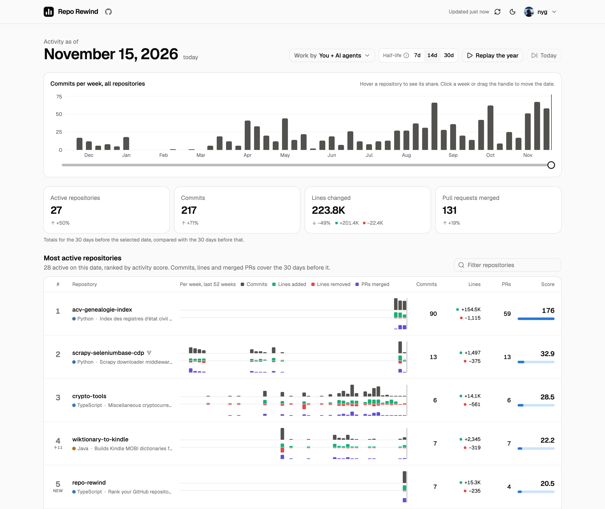

# Repo Rewind

A dashboard that ranks your GitHub repositories by how active they are, and lets you drag a date slider to see what you were working on at any point in the last year.

It is a static site: React, Vite, Tailwind CSS and shadcn/ui. The browser talks to the GitHub API directly, so there is no backend.



## What it shows

- Every repository you own, ranked by an activity score on the selected date.
- Per repository and per week: commits, lines added and removed, pull requests merged.
- A timeline of all commits. Click a week, drag the handle, or replay the year to watch the ranking change.
- A detail panel per repository with the score over time, pull requests opened and merged, and a table view.

## Activity score

Every event adds points on the day it happens, and points fade with a half-life of 7, 14 or 30 days.

| Event | Points |
| --- | --- |
| Commit on the default branch | 1 to 2, growing with the size of the diff and capped at 1,000 changed lines |
| Pull request opened | 1 |
| Pull request merged | 1 |

The "Work by" filter chooses whose events count: you, AI agents (Copilot, Claude, Codex…), automation (Renovate, Dependabot, GitHub Actions…) or other people. In forks only the owner's commits are fetched.

## Run it

```bash
pnpm install
```

```bash
pnpm dev
```

## GitHub access

Without a token the app reads public data only: the 12 most recently pushed public repositories, without line counts, within GitHub's limit of 60 anonymous requests per hour.

With a token it uses the GraphQL API and shows everything, private repositories included. Create a [fine-grained personal access token](https://github.com/settings/personal-access-tokens/new) with read-only access to **Contents**, **Metadata** and **Pull requests** for all repositories, then paste it in the account menu.

Signing in with GitHub also uses the GraphQL API. By default it asks for no permissions and shows every public repository with line counts, but no private ones. The visitor can turn on **Include private repositories** before signing in. GitHub has no read-only OAuth scope for private repositories, so this asks for the `repo` scope, which grants read and write access, although the app only reads. Private repositories of an organization also need that organization to approve the OAuth App.

Either way the access token is stored in this browser's `localStorage` and is only sent to `api.github.com`. The production build ships a Content Security Policy that blocks requests to any other host, apart from the sign-in service.

Fetched data is cached in `localStorage`. A refresh only refetches repositories that changed.
